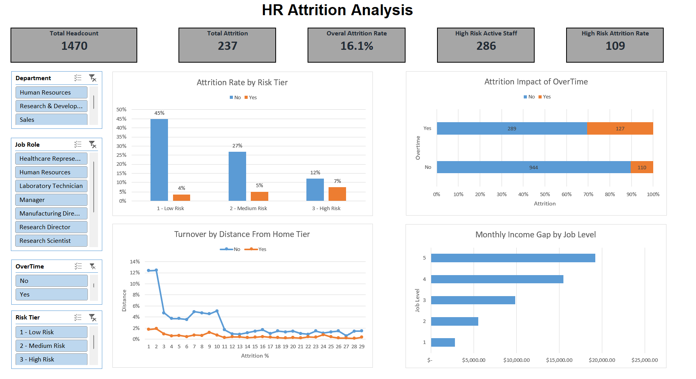
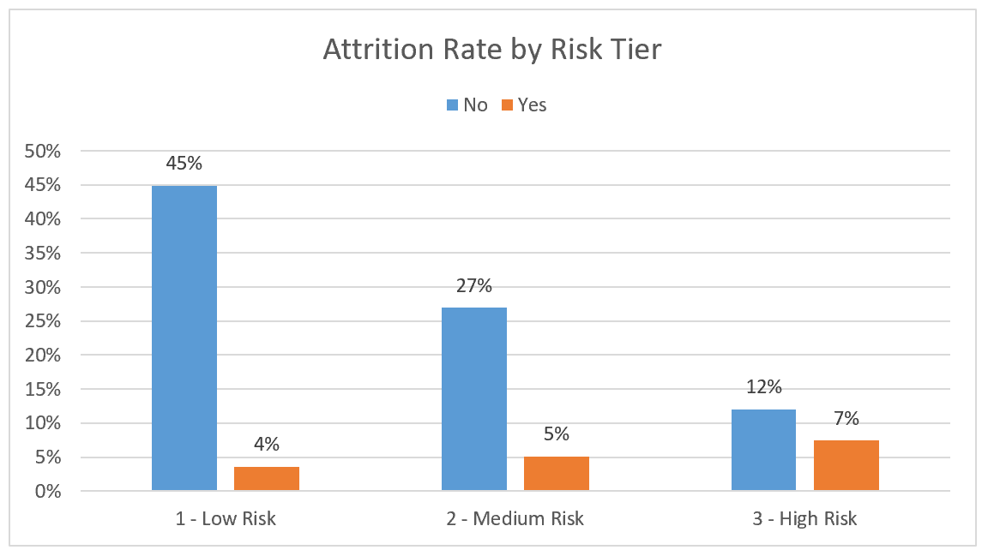
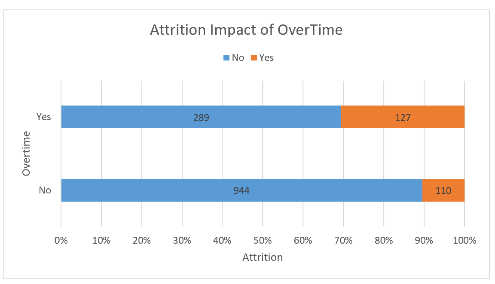
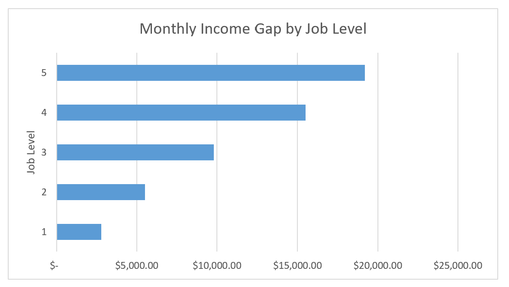
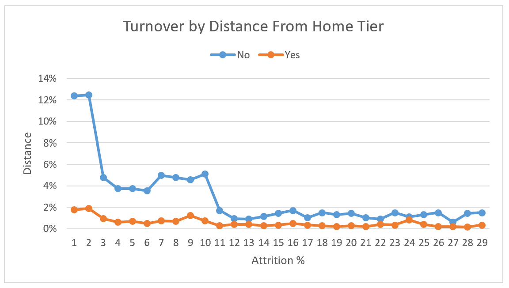

# HR Employee Attrition & Retention Analysis

## Project Overview
This project provides an end-to-end, data-driven diagnostic of employee turnover across 1,470 employees. Combining descriptive analytics, inferential statistical testing (Welch's t-Test, Chi-Square Test of Independence, and Multiple Linear Probability Regression), and a 10-point Risk Scoring Model, this analysis identifies the core drivers of attrition and delivers a targeted retention framework for leadership.

---

## Dataset Reference
* **Dataset Name:** IBM HR Analytics Employee Attrition & Performance
* **Dataset Source:** [Kaggle - IBM HR Analytics Attrition Dataset](https://www.kaggle.com/datasets/pavansubhasht/ibm-hr-analytics-attrition-dataset)
* **Sample Size:** 1,470 Records x 35 Baseline Attributes

---

## Key Performance Indicators (KPIs)
* **Total Headcount:** 1,470 Employees
* **Total Departures:** 237 Employees
* **Baseline Attrition Rate:** 16.1%
* **High-Risk Active Staff:** 286 Employees (Identified for immediate retention intervention)
* **High-Risk Attrition Rate:** 38.1% (vs. 7.4% in Low-Risk Tier)

---

## Dashboard Visual Preview

*Figure 1: Executive Dashboard showing KPI summary cards, interactive department/role slicers, risk distribution, overtime impact, pay gap by job level, and commute distance trends.*

---

## Core Analytics & Visual Insights

### 1. Attrition Risk Model Performance

*Figure 2: Attrition rate escalation across Risk Tiers (Low: 7.4%, Medium: 15.9%, High: 38.1%).*

* **1 - Low Risk (0–2 pts):** 713 employees | 7.4% Attrition Rate
* **2 - Medium Risk (3–4 pts):** 471 employees | 15.9% Attrition Rate
* **3 - High Risk (5+ pts):** 286 employees | 38.1% Attrition Rate (Captures 46% of all historic leavers)

---

### 2. Overtime Impact (#1 Attrition Driver)

*Figure 3: Overtime employees leave at 30.5% compared to 10.4% for non-overtime staff.*

* **Chi-Square Result:** Chi-Square = 89.04, df = 1, p-value < 0.001.
* **Finding:** Working overtime increases departure risk by nearly three times.

---

### 3. Monthly Income Disparity

*Figure 4: Average monthly income gap between stayers and leavers concentrated in Job Level 1.*

* **Welch's t-Test Result:** t(413) = 7.48, p-value < 0.001.
* **Finding:** Statistically significant $2,046 monthly pay gap between stayers ($6,833) and leavers ($4,787), heavily driven by entry-level (Job Level 1) roles.

---

## Attrition Risk Scoring Model Rules

| Factor | Criteria | Points Assigned | Empirical Justification |
| :--- | :--- | :---: | :--- |
| **OverTime** | `OverTime = "Yes"` | **+3** | #1 Attrition driver (Chi-Square = 89.04, p < 0.001). |
| **Low Job Satisfaction** | `JobSatisfaction <= 2` | **+2** | Strong qualitative departure predictor. |
| **Entry-Level Low Pay** | `JobLevel = 1` AND `MonthlyIncome < 3500` | **+2** | Significant Welch's t-test pay gap (t = 7.48). |
| **Promotion Stagnation** | `YearsSinceLastPromotion >= 4` | **+1** | Statistically significant in regression (p = 0.0008). |
| **Long Commute** | `DistanceFromHome >= 15` | **+1** | Statistically significant in regression (p = 0.0018). |
| **Poor Work-Life Balance** | `WorkLifeBalance = 1` | **+1** | Significant indicator of burnout risk. |

---

## Workbook Sheet Index

| Sheet Name | Classification | Description & Key Visuals |
| :--- | :--- | :--- |
| **README** | Documentation | Project overview, dataset link, image index, and navigation guide. |
| **Dashboard** | Presentation | Executive dashboard featuring KPI cards, slicers, and 4 core charts. |
| **Analysis** | Aggregation | Pivot summaries evaluating turnover across Risk Tiers, OverTime, and Departments. |
| **Cleaned Data** | Data Layer | Master cleaned data table (1,471 rows x 47 columns) with calculated risk fields. |
| **Raw Data** | Data Layer | Unmodified IBM HR dataset containing 35 standard attributes. |
| **Calc** | Working Layer | Intermediate calculation tables, dollar gaps, and percentage variances. |
| **Statistical Tests** | Analytics | Welch's t-Test, Chi-Square Test, and Linear Probability Regression outputs. |
| **Corelation** | Analytics | Pearson correlation matrix evaluating continuous metrics vs Attrition Flag. |
| **Data Dict** | Documentation | Column-level metadata, data types, value ranges, and field descriptions. |

---

## Strategic Action Plan
1. **Immediate Intervention:** Target the 177 active employees currently flagged in the High Risk tier with stay interviews and workload reviews.
2. **Overtime Caps:** Implement quarterly overtime limits and workload redistribution in high-turnover units.
3. **Entry-Level Salary Alignment:** Review market benchmarks for Job Level 1 compensation to reduce early-career churn.
4. **Career Progression:** Establish structured 2-year and 4-year tenure review pathways to eliminate promotion stagnation.

---

